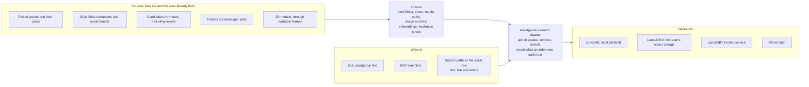

# Assetgrove Search PRD

Assetgrove Search finds a game's assets by how they look, by what they show and by their metadata, from inside the developer's harness, with nothing hosted. It turns a growing asset library from a folder tree into something a developer or their agent can ask questions of.

- **What it is:** a local index of every asset, card, reference and candidate in a game's repository, built with LanceDB in a folder on the developer's machine. It sits behind Assetgrove's own search adapter, so the backend can change without touching anything else.
- **How it's reached:** a CLI command, an MCP tool, and a tree of MCP resources that behaves like a browsable filesystem of the library, with views and search paths.
- **Local first, cloud optional:** search runs on the machine by default. A team that wants one shared library can point the same adapter at LanceDB in their own object storage, or at LanceDB's hosted service with their own key.
- **The record stays in Git:** a card of metadata sits next to every asset. The index is a cache built from those files and rebuilt whenever it's stale, so it can never disagree with the repository for long.

It ships in Phase 2 of 1.0, asset management and search, as its own optional package ([Assetgrove 1.0 PRD](PRD.md#phase-2-asset-management-and-search)).

## Jobs it does

A library of a few hundred assets is easy to hold in your head. A library of a few thousand, across several games and with rejected mockups beside it, is not. Search answers the questions people actually ask of it.

| Who asks  | The question                                          | How it's answered                                                                         |
| --------- | ----------------------------------------------------- | ----------------------------------------------------------------------------------------- |
| Developer | "Find mockups like this one"                          | By look: image similarity to a picked asset, a reference or any image file                |
| Developer | "Where are the mossy rocks?"                          | By meaning: the words matched against the images themselves, not only their cards         |
| Developer | "Which icons were made under the old style bible?"    | By fields: exact filters on the card                                                      |
| Agent     | "Do we already have a lantern before I spend on one?" | Combined: meaning and look, filtered to picked assets, checked before any paid generation |
| Agent     | "Which assets in this set don't match the rest?"      | By look: assets whose nearest neighbours are far from the rest of their set               |
| Developer | "Did I make something like this in another game?"     | Across every game indexed on the machine                                                  |
| Team      | "Show the whole studio's library"                     | The same queries against a shared index, when the team chooses one                        |

## Principles

1. **An optional add-on.** Search ships as its own package, `@clockgrove/assetgrove-search`, installed on top of Assetgrove. Assetgrove works fully without it, and turns on the search commands, tools and resources only when the add-on is installed. The package ships its own skill, assetgrove-search, in the Agent Skills format, so an agent learns search only where it's installed. Reason: LanceDB and the embedding model are large, and many developers won't need search on day one.
2. **Local by default.** The index, the embedding model and every query run on the developer's machine, with no account and no network after the model is downloaded. Reason: the developer's art stays theirs, and search works offline.
3. **Git is the record; the index is a cache.** Cards and provenance are committed next to each asset. The index is built from them and can be deleted and rebuilt at any time, so it never becomes a second source of truth.
4. **Behind an adapter.** Assetgrove talks to search through its own small interface: index these items, find by text, by image or by fields. LanceDB is the first backend, and a backend can be swapped without touching the rest. Reason: LanceDB is pre-1.0, and a team may want a different store.
5. **Cloud only with the developer's own key.** Sharing an index, through the team's own object storage or LanceDB's hosted service, is opt-in and uses credentials the developer provides, like every other route in Assetgrove.
6. **Reading is a resource, changing is a tool.** Browsing and searching never pick, spend or edit anything. Those stay tools with their own confirmations.
7. **No UI of its own.** Results come back as contact sheets the harness shows and as JSON for the agent, the same way candidates do. A visual library comes later with Assetgrove's viewer.

## How it fits together

The indexer reads the files Git already holds, the adapter stores and searches what it builds, and the three ways in all ask the adapter the same questions.



Swapping the backend changes nothing to the left of the adapter or below it; deleting the index loses nothing that the sources can't rebuild.

## Asset cards

Every picked asset gets a card, and the card is a concept in the [Open Knowledge Format](https://github.com/GoogleCloudPlatform/open-knowledge-format) (OKF, v0.2, Apache-2.0): a Markdown file with YAML front matter, built for files that agents write and people review in Git. A game's asset folder is an OKF bundle. Assetgrove writes the card when the asset is picked, and anyone can edit it after.

```markdown
---
type: Game Asset
title: Porch lantern
description: A brass lantern for the porch, lit, from the game's camera.
resource: lantern-porch.png
tags: [prop, light, porch, night]
generated: { by: assetgrove/1.0 via bfl/flux-2-pro, at: 2026-11-13T21:04:00Z }
verified:
  - { by: process:assetgrove-qa, at: 2026-11-13T21:04:30Z }
  - { by: human:dev, at: 2026-11-13T21:10:00Z }
sources:
  - { id: provenance, resource: lantern-porch.png.provenance.json }
  - { id: bible, resource: ../art/BIBLE.md }
subject: lantern
state: picked
bible: v3
licence: CC-BY-4.0
---

Used beside the front door; the warm glow should match the window light.
```

| Our need                               | OKF field                                                                                                                                                     |
| -------------------------------------- | ------------------------------------------------------------------------------------------------------------------------------------------------------------- |
| What kind of asset                     | `type`, the one required field                                                                                                                                |
| The file it describes                  | `resource`                                                                                                                                                    |
| Name, summary, tags                    | `title`, `description`, `tags`                                                                                                                                |
| How it was made                        | `generated`, plus `sources` pointing at the provenance record and the style bible                                                                             |
| Passed QA, then picked by a person     | `verified`: a `process:` entry for QA and a `human:` entry for the pick. OKF derives a trust tier from these: unverified, machine-confirmed or human-reviewed |
| Subject, state, bible version, licence | Assetgrove's own fields, which OKF allows and requires readers to keep                                                                                        |
| What the developer and agent read      | The body                                                                                                                                                      |

- **Provenance stays the precise record.** The JSON beside the asset keeps the exact prompt, seed, route and cost. The card points to it and repeats only what's worth filtering on, so a hand edit to the card can never rewrite how the asset was made.
- **Folder indexes:** each folder of the bundle carries an `index.md` listing its assets with their descriptions, the OKF convention for browsing one level at a time. It matches the asset tree's rule that every folder address is readable.
- **Folder logs, on by default:** each folder also carries a `log.md`, the OKF history file, newest first and grouped by date. Assetgrove adds one line for each of its own actions: pick, replace, approve, reject, a change request answered, a card edited through the tool, and a style bible change with what it marked out of date. Entries come from the review and provenance records and link to the card, so the log never says something the records don't, and it can be rebuilt from them.
- **No merge conflicts on logs:** setup marks `log.md` with Git's union merge driver (`log.md merge=union` in `.gitattributes`), so entries added on two branches are both kept.
- **Other tools can read the library.** Anything that reads OKF, such as Obsidian, MkDocs or Google's Knowledge Catalog, can browse a developer's assets; Assetgrove search is one more reader.
- **The version is recorded:** the bundle's root `index.md` carries `okf_version: 0.2`. OKF is a draft, so Assetgrove uses its core fields and keeps everything else in its own.
- **Without the add-on,** cards, indexes and logs are still written and committed. They are part of core Assetgrove.

## What gets indexed and how it stays fresh

The index covers everything a developer might want to find again, not only the finished art. Each item is stored with its card fields, its prose, the path to its media, and two embeddings: one of the image and one of the text, both from the same image-and-text model so a word can find a picture.

| Source                                             | Where it lives                   | Indexed by default                                         |
| -------------------------------------------------- | -------------------------------- | ---------------------------------------------------------- |
| Picked assets and their cards                      | The game's repository, committed | Yes                                                        |
| Style bible references and mood boards             | The game's repository, committed | Yes                                                        |
| Candidates from runs, including rejects            | The run folder, outside Git      | Yes, marked as candidates; the developer can turn this off |
| Any folder the developer adds, such as concept art | Wherever they point it           | Only when added                                            |
| 3D models                                          | The game's repository            | Through their turntable frames, one embedding per view     |

- **Where the index lives:** in the developer's own state folder, outside every repository, one index per machine covering every game added to it. Nothing about the index is committed.
- **Embeddings:** a local image-and-text model (CLIP or SigLIP, through Transformers.js) by default, downloaded once. A developer can choose a hosted embedding route with their own key instead. The model's name and version are stored with every embedding, and changing the model means reindexing.
- **Freshness:** each game's entry records the Git commit and the file hashes it was built from. A search first checks those cheaply; anything changed since is reindexed before the query runs. Branch switches, pulls and hand-edited cards are all caught this way.
- **Rebuilding:** deleting the index folder is always safe. The next search rebuilds it from the files.
- **Versions:** LanceDB keeps versions of its tables, and each version is tagged with the commit it reflects, so "is this index current?" is one comparison.

## Searching

One search takes any mix of three inputs: words, an image, and field filters. It returns ranked assets with their cards, as a contact sheet for the person and JSON for the agent.

| Input    | Example                                                                  | How it ranks                                                                     |
| -------- | ------------------------------------------------------------------------ | -------------------------------------------------------------------------------- |
| Words    | `assetgrove find "mossy rock"`                                           | Meaning against the images and the card prose, plus keyword matches on the cards |
| An image | `assetgrove find --like mockups/rock-03.png`                             | Image similarity                                                                 |
| Fields   | `assetgrove find --where "kind=prop licence=CC-BY-4.0 bible<v3"`         | Exact filters, no ranking                                                        |
| Combined | `assetgrove find --like lantern-porch --where "state=picked" --game all` | Similarity, filtered                                                             |

- **The same search everywhere:** the CLI command, an MCP tool of the same name, and the search paths in the asset tree below all call one search.
- **Results:** a numbered contact sheet with each match beside its score and card fields, plus JSON with paths, scores and cards. The contact sheet is the same kind of image the developer already uses to pick candidates.
- **Before spending:** when the agent plans a paid generation, Assetgrove searches for near matches first and shows them with the cost forecast: "three existing lanterns look close; reuse one, or generate?" The developer can turn this off.
- **Set outliers:** `assetgrove find --outliers <set>` lists the assets in a set whose nearest neighbours are farthest from the rest, a cheap second check on style consistency.
- **Scope:** one game by default, every indexed game with `--game all`.

## The asset tree

The library is exposed as MCP resources: a tree of addresses an agent can list and read like a filesystem, and a person in Claude Code can pull into the conversation with an @-mention. The same asset appears in several views; nothing is copied.

```
asset://<game>/
  by-kind/<kind>/<asset>
  by-subject/<subject>/<asset>
  by-tag/<tag>/<asset>
  stale/<asset>                      picked under an older style bible
  runs/<run>/<candidate>             candidates, including rejects
  <asset>/image  <asset>/card  <asset>/provenance
  find/{words}                       search by meaning
  like/{asset}                       search by look
  where/{filter}                     search by fields
```

- **Search paths** use MCP resource templates, so a saved search reads like a folder: `asset://fern-quest/like/lantern-porch`.
- **Browsing never changes anything.** Resources are read-only; picking, editing a card or reindexing are tools.
- **Live:** the tree announces when its listing changes, and a run folder can be subscribed to, so new candidates appear as they pass QA.
- **Size limits:** an image resource is a thumbnail by default, with the full file one step away. Claude Code caps a result at 25,000 tokens by default. A 3D model reads as its turntable frames plus the file's path.
- **From the CLI:** `assetgrove ls` and `assetgrove cat` walk the same addresses, for people and scripts.
- **Core, not the add-on:** cards and the views that need no index (by kind, by subject, by tag, stale, runs, and each asset's files) are part of Assetgrove itself, served from the cards. The add-on adds the search paths.

Every folder address is itself readable and returns its children, so anything that can only read resources, such as an MCP App, can browse the whole tree. The viewer that will do that is in the [Assetgrove Viewer PRD](PRD-viewer.md).

## The adapter and its backends

Assetgrove talks to search only through its own adapter, and LanceDB is the first backend behind it. The adapter asks for four things: add or update items, remove items, search by any mix of words, image and fields, and report what an index was built from. Nothing outside the adapter imports LanceDB.

| Backend                   | Where the index lives                   | Who it's for                         | What the developer provides    |
| ------------------------- | --------------------------------------- | ------------------------------------ | ------------------------------ |
| LanceDB, local (default)  | A folder on the developer's machine     | Solo developers                      | Nothing                        |
| LanceDB in object storage | The team's own bucket, such as S3 or R2 | Small teams sharing one library      | The bucket and its credentials |
| LanceDB's hosted service  | LanceDB's cloud                         | Teams that don't want to run storage | A LanceDB key                  |
| Others later              | Depends on the backend                  | Anyone with an existing store        | Its connection details         |

- **Why LanceDB:** it is built for this kind of data. It stores vectors, metadata and media references together, searches by vector similarity, full text and SQL filters in one table, runs inside the process with its data in a folder, and versions its tables. It is Apache-2.0 licensed, with native builds for Linux, Windows and Apple Silicon.
- **Why an adapter anyway:** LanceDB is pre-1.0 (0.41.0), so its API will move, and the adapter keeps that churn in one place. It also lets a team bring a store it already runs, such as Postgres with pgvector, as another backend.
- **The same calls for every backend.** A developer moves from local to shared by changing settings, not commands. The settings live in the developer's own configuration, never in the repository, because they can carry credentials and decide where data is sent.

## Trust and privacy

By default nothing leaves the machine except the one-time download of the embedding model.

| Area                       | Rule                                                                                                                                                                    |
| -------------------------- | ----------------------------------------------------------------------------------------------------------------------------------------------------------------------- |
| **Local use**              | The index, the model and the queries stay on the machine. No account, no telemetry                                                                                      |
| **Shared index**           | Only card fields, card prose, media paths and embeddings are written to the shared store. Images are never uploaded by search; they stay in Git and Git LFS             |
| **Embeddings**             | Embeddings can reveal something about an image, so `init` says that a shared index exposes them to whoever can read the store                                           |
| **Hosted embedding route** | Sends the images to that provider, under the developer's own key and that provider's terms. `init` names the provider before the first run                              |
| **Credentials**            | A bucket's credentials or a LanceDB key come from the developer's own settings or environment, never from a repository file. A key goes only to its own service's hosts |
| **Shared text**            | Card prose and tags from a shared repository reach the agent as labelled data, never as instructions, and contact sheets carry none of it                               |
| **Spend**                  | A hosted embedding route or LanceDB's hosted service bills the developer directly. Their calls are reserved against Assetgrove's spend caps like any other paid call    |

## Non-goals

- **No hosted service of our own.** Sharing uses the team's own storage or LanceDB's service, with their credentials.
- **No second source of truth.** The index never holds anything that isn't rebuildable from files.
- **No general digital asset manager.** No check-in and check-out, no approval workflow, no version control beyond Git. Search finds; Git records; Assetgrove makes and picks.
- **No search of files outside what a developer adds.** It indexes a game's repository, its runs and folders the developer names, nothing else on the disk.
- **No UI of its own** until Assetgrove's viewer exists.
- **Not required.** Every Assetgrove feature works without the add-on.

## Success measures

Bars marked "set later" are fixed on a labelled test library before the add-on is built against them, never after seeing results.

| Measure                        | Bar                                                                                   | How it's measured                                     |
| ------------------------------ | ------------------------------------------------------------------------------------- | ----------------------------------------------------- |
| Finds the right asset by look  | Set later: the share of queries whose known match is in the top 5                     | A labelled test library of asset pairs                |
| Finds the right asset by words | Set later: the same, for written queries                                              | The same labelled set, with a written query per asset |
| Search speed                   | Under 1 second for a library of 10,000 assets on a laptop, after the index is fresh   | Timed on the test library plus synthetic padding      |
| Freshness check                | Under 1 second when nothing has changed                                               | Timed                                                 |
| First index                    | Reported, with no bar: the time to index the test library on a laptop CPU             | Timed                                                 |
| Rebuild is safe                | Deleting the index and searching again gives the same results                         | A test                                                |
| Reuse before spend             | The share of planned generations where the developer reused an existing asset instead | Run records, by choice                                |
| Works without the add-on       | Every Assetgrove command and test passes with the add-on absent                       | CI                                                    |

## Risks

| Risk                       | What could happen                                                                                                       | How we handle it                                                                                  |
| -------------------------- | ----------------------------------------------------------------------------------------------------------------------- | ------------------------------------------------------------------------------------------------- |
| LanceDB API churn          | A 0.x release changes calls Assetgrove depends on                                                                       | Everything goes through the adapter; LanceDB is pinned to an exact version and moved deliberately |
| No Intel Mac build         | LanceDB ships native builds for Apple Silicon but not Intel Macs                                                        | Search says so at install; another backend can fill the gap if Intel Mac users ask                |
| Search quality             | General image-and-text models miss what matters in game art, such as pixel art or one character against its look-alikes | The labelled test set sets the bars first; the model is a setting, so a better one can replace it |
| Stale results              | The index lags behind a pull or a hand edit                                                                             | The freshness check runs before every search                                                      |
| Embedding leakage          | A shared index reveals more about unreleased art than a team expects                                                    | `init` says what a shared index exposes; sharing is opt-in                                        |
| Cards add repository noise | A card per asset doubles the file count in the repository                                                               | Cards are small text files, kept next to each asset                                               |
| Harness support            | Some harnesses don't support MCP resources or @-mentions                                                                | The CLI and the `find` tool cover the same searches in every harness                              |

## Open questions

To answer before building:

- how LanceDB's hosted service is connected from the Node SDK with a key, and what it costs;
- whether LanceDB's Node SDK combines vector and full-text ranking in one query, or Assetgrove merges the two;
- which image-and-text model to start with, and the licence of its weights;
- how Cursor, VS Code and Codex handle MCP resources and @-mentions, next to Claude Code.
