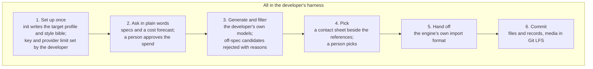
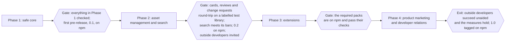

# Assetgrove 1.0 PRD

## Summary

Assetgrove 1.0 is an open-source AI-art tool that lets a solo or indie developer produce a game's art at a consistent, high quality without outside art expertise, working from inside their coding agent.

- **Who it is for:** solo developers and small teams who build with an agent harness (Claude Code, Cursor, Codex, VS Code with Copilot). 1.0 serves Godot and any engine that reads standard sprite-atlas files. Unity follows.
- **What it does:** the developer describes the game's look once, as a style bible. Then they ask for assets in plain words: characters, animations, tiles and icons. Assetgrove generates candidates with the developer's own keys and models, rejects the ones that miss the spec, and shows the rest as contact sheets and preview files in the harness. The pick lands in the game's repository in the engine's own import format, with a record of how it was made.
- **Why this and not a hosted tool:** hosted tools sell their own credits and models, one vendor at a time. Assetgrove is the vendor-neutral layer around generation: your keys and models, theirs included; one style across all of them; automatic rejection of off-spec candidates; and the result committed to your repository with its record.
- **Positioning:** we say plainly that this is AI art. It is for developers who chose AI art and want it to be good, consistent and honest: disclosed, traceable and with its terms recorded. It doesn't pretend to be an artist, and it doesn't replace one where a team has one.
- **North star:** a developer opens their game in their harness, asks for a set of assets, picks from in-spec candidates, and the picks are in the engine and committed to Git. Every file can be traced to how it was made, and spend is limited at the provider as well as counted locally.
- **Name:** the project is Assetgrove, kept under the Clockgrove organization. A trademark check on the name is still to do.

## Where it stands today and what 1.0 adds

The core is already generic. 1.0 is the work around it that makes it usable by someone who isn't us. Assetgrove already ships the generation loop with provenance and cost caps, sprite sheets with animation QA, material maps, image-to-3D characters with motions, look-dev, detail levels, and a hand-off that passes the target's own validator.

What stops an indie developer using it today:

| Today | 1.0 |
| --- | --- |
| Not on npm; no starter setup | One install, and `init` in the harness writes a starter style bible and target profile |
| Hand-off writes one manifest from a template | Presets that write Godot's own import files and standard atlas JSON |
| Picking from the CLI or JSON | Picking from contact sheets in the harness, with picks and spend confirmed by a person |
| An MCP server on the official SDK with 5 tools; the CLI has 20 commands | Every operation is an MCP tool, and the asset library is browsable as MCP resources |
| One gateway key, plus Tripo | Your own keys per provider, local models, and hosted asset vendors as routes |
| Spend caps the agent could edit | A limit at the provider, checked at setup, and local caps the agent can't raise |
| Proven on one naturalistic character | Proven in daily use on our own games, and on pixel art through a spike |
| One game's names baked into the docs, tests and settings | Docs and tests that name no other project |
| A provenance record per pick; nothing to browse, review or change by region | A card, a review record and a version history per asset, an index and a log per folder, and change requests by region |

## Principles

Eight principles shape 1.0.

1. **Harness-only, no UI in 1.0.** Everything happens in the developer's agent harness, through MCP tools and the CLI. 1.0 has no UI of its own: no hosted service, no web page, no MCP App. Candidates are contact sheets and preview files, and picks and spend are confirmed through the harness's own prompts. Reason: harnesses differ widely in what they can draw, and a UI is a rabbit hole best entered with outside developers' feedback in hand. A viewer comes after 1.0, shaped by that feedback.
2. **A person picks and spends.** Picking an asset, starting paid work and raising a cap each go to the developer, through a prompt the harness shows a person. These controls stop an agent that is over-eager or has drifted. They don't stop an agent set on getting round them, because it holds a shell; the limit on money sits with the provider. Reason: a small promise we keep is worth more than a large one we can't.
3. **Bring your own key, bring your own model.** The developer's own keys pay for every call. A local model can sit behind the adapter, and a hosted asset vendor's API is one more route. Assetgrove never holds or resells keys or credit. Reason: no billing for us to run, no lock-in for them, and local models for those who want privacy or zero cost.
4. **The engine's format, not ours.** A pick lands in the engine's own import format, ready to use. Reason: an asset the developer must convert by hand isn't finished.
5. **Honest AI art.** Every output is marked as generated, in the file where the format allows and always in its record. A disclosure summary is ready for store forms, and the prompt policy refuses living artists' styles, copyrighted characters and real people. Reason: indie communities are wary of AI art, and our credibility rests on never hiding it.
6. **Use what exists.** Official SDKs and maintained libraries come before our own code, and existing vendors are routes, not rivals. Hand-written protocol, format or codec code needs a recorded reason. Reason: every line we write is ours to maintain, and one person maintains this.
7. **Game as data.** Anything specific to one game, one engine or one style is a profile, a preset or a style bible: data, never code. Data is never trusted to run code or to choose where keys are sent. No game is special to the tool.
8. **Git is the record.** The game's repository holds the style bible, the picks, their cards and review records, and each folder's index and log, with media in Git LFS. Git is required: it gives source control, review and protection from data loss.

Six standing rules hold as well:

- Assetgrove never marks anything approved;
- provenance is part of the asset;
- spend is reserved against a cap before each call;
- media is format-agnostic;
- providers sit behind adapters;
- tests run offline.

## Users and jobs

The primary user is a solo developer who can code but not draw, and who works through an agent.

| User | Job | What they need from 1.0 |
| --- | --- | --- |
| Solo developer, no art background | Get a whole game's art to one consistent look, picked in minutes, not commissioned over weeks | `init` in five minutes, a style bible written with them, contact sheets, Godot presets |
| Small team with an artist | Fill gaps around the artist's key art, which serves as references and the bible | Identity and style locks against the artist's references, edits to existing art, no style drift |
| Their coding agent | Request, stage and hand off assets inside a task, with picks and spend going to a person | Every operation as an MCP tool, JSON results, spend caps on every path |
| A game that already uses it | Produce a world's cast, animations, props and sounds under its own style and validator | Everything shipped so far keeps working; its own checks run from its own repository |
| Creators of style bibles and engine presets | Share a look or an engine preset with others | Shareable bibles and presets that are safe to open (see [Trust, safety and legal](#trust-safety-and-legal)) |

**Not our user:** studios that want a hosted asset management platform, artists looking for a drawing tool, and anyone wanting to pass generated art off as hand-made.

## The experience

The developer starts and finishes everything in their harness. The agent drives Assetgrove through MCP tools, and the two moments that need a person, approving spend and picking, are confirmed through the harness's own prompts.

1. **Set up once.** "Set up Assetgrove for my Godot pixel-art platformer." The agent runs `init`, which writes a target profile from the Godot preset and a starter style bible drafted with the developer. It then walks them through two things only they can do: putting their key where their harness reads it, and setting a spending limit at the provider. Keys never go into the repository.
2. **Ask in plain words.** "I need the knight's idle, run and attack, and twelve forest tiles." The agent writes the specs and Assetgrove forecasts the cost. The developer approves the spend.
3. **Generate and filter.** Assetgrove calls the developer's own models, post-processes each candidate to the engine's spec, and rejects the ones that miss the spec, the identity or the style, with reasons.
4. **Pick.** The harness shows what's left as a numbered contact sheet beside the references, with preview files for animations and 3D. The developer picks, rejects with a reason, asks for variations of one candidate, sends a note for another round, or marks a region by its coordinates and asks for a change there.
5. **Hand off.** The pick is written in the engine's own import format. Replacing an asset that's already in the game keeps the engine's references to it working.
6. **Commit.** The files and their records are committed, media through Git LFS, and the developer reviews them as any other change.

### How the developer sees and confirms

1.0 shows candidates as image files and asks for decisions through prompts the harness already has. Which harness supports what is as of 2026-11-13, and Phase 1 proves each row in a real host. Codex's support for these prompts is unverified.

| Asset kind | What the developer sees |
| --- | --- |
| Stills, tiles, icons | One contact sheet per round: the references beside the candidates, each numbered, with its QA reasons and cost as text beside it |
| Animations | A contact sheet of key frames per candidate, plus a looping preview file |
| 3D models | Turntable frames per candidate, plus a turntable preview file |

| Harness | How a pick or spend is confirmed |
| --- | --- |
| Local: Claude Code, Cursor, VS Code | A form the harness shows the person (MCP elicitation). In Claude Code the pick and spend tools are also marked to require the person in every permission mode, so auto mode never answers for them |
| Remote sessions: Claude Code on the web or a phone | The same form, shown as a card |
| No person present: CI and other unattended runs | Headless mode, set by the operator outside the repository. Picks and spend are recorded as unattended |

- A spend approval names the planned jobs, the candidate count, the forecast and the cap, and carries the server's own digest of the plan, so the plan can't change after it is approved.
- A developer can set their harness to answer these prompts automatically. Assetgrove can't prevent that. `init` says so, and the record of each pick says how it was confirmed.
- Contact sheets carry no text from shared files.

## What the controls stop, and what they don't

Assetgrove's controls are built to stop an over-eager or drifting agent, and text in shared files that tries to steer one. They are not built to stop an agent that sets out to get round them: it holds a shell on the developer's machine, and nothing running there can fully contain it. The one limit it can't touch is the provider's.

| Promise | How far it holds | How |
| --- | --- | --- |
| Spend can't pass the developer's limit | Holds, at the provider | A dedicated key with prepaid credit or a per-key budget. `init` checks for the limit where the provider exposes it, and an unlimited key needs the developer's explicit say-so |
| A pick or a paid run started through Assetgrove goes to a person | Holds in every supported harness, unless the developer sets theirs to answer automatically | The harness's own form, and in Claude Code a tool marked to require the person |
| The agent's shell can't reach the key or the provider | Depends on the harness | A recipe per harness from `init`: the key in the server's settings, not the shell's, and the sandbox blocking provider sites from the shell |
| Local caps count every paid call made through Assetgrove | Best-effort | Caps are read from the developer's own settings outside the repository, and only a person raises them. Whether a call costs money is a property of the provider's adapter, never of its name |
| Spending outside Assetgrove is noticed | Best-effort | After each run the ledger is compared with the provider's own usage figures, where the provider reports them. A gap stops further runs |
| Shared files run no code and can't choose where keys go | Holds for Assetgrove's own code, once Phase 1 closes the list | Shared files name no commands and no endpoints; see [Phase 1](#phase-1-safe-core) |
| Text in shared files doesn't steer the agent | Best-effort | Assetgrove's tools pass it as labelled data, and contact sheets carry none of it. The agent can still read the files itself |
| The record of how a pick was confirmed | Self-reported | The record says so |

Which providers offer a hard limit per key is not yet verified. Phase 1 checks each supported provider before the quick start promises it.

## Scope of 1.0

1.0 is the smallest release that meets the north star for a real indie developer on Godot. Each phase ends at a gate that checks everything in it, and what doesn't fit is listed under "After 1.0". Every phase ships its skills with its code: a feature isn't done until the skill that teaches an agent to use it is.

### Phase 1: safe core

- **Built on the official SDKs.** Every CLI operation is an MCP tool on the official MCP SDK, with the same results and rules. A long generation reports progress and survives a dropped connection.
- **Confirmation per harness,** as in the table above, proven in real hosts: Claude Code locally and in a remote session, and one more harness.
- **Spend:**
  - a limit at the provider is required at `init`, and checked where the provider exposes it;
  - a recipe per harness keeps the key out of the agent's shell;
  - caps are read from the developer's own settings outside the repository, and only a person raises them;
  - the ledger is compared with the provider's usage after each run;
  - whether a call costs money is a property of the provider's adapter, never of its name.
- **Shared files can't run code or steer keys.** This covers every place a file can name a command or an endpoint today: the validator and preview commands, the material encode and compression commands, provider scripts, the gateway relay address, and a committed harness config that sets the server's environment. A command the developer writes runs only after they approve it; the approval is tied to that exact command and kept outside the repository. Endpoints come only from the developer's own settings.
- **Unattended runs** use a headless mode the operator sets outside the repository. `--auto-approve` is removed from every tool an agent can call.
- **Keys:** a recipe per harness for where the key goes, tested in the quick start. `init` never writes a key and refuses a repository that tracks one, and provider errors are redacted before they reach logs or the agent.
- **Licences:** a route with no declared grant can't hand off until the developer declares one. `init` lists every provider a route sends data to.
- **The prompt policy,** best-effort: a blocklist plus one model check refuse a prompt that names a living artist's style, a copyrighted character or a real person, before spend.
- **Linux, macOS and Windows** pass CI, including Windows paths: long paths, case and separators.
- **No product names in the core:** the settings named after a CI product become generic ones.
- **The name:** a trademark check on Assetgrove, before the first npm release.

The rest of the core belongs here too, so later phases only add:

- **The extension contract:** engine presets, asset kinds and provider routes plug in as their own packages through a small, versioned interface. Core ships the generic ones.
- **Core routes:** the Vercel AI Gateway, an Anthropic key and an OpenAI key as the top-level choices at `init`, and any OpenAI-compatible endpoint, which covers most local servers. A local-only setup makes 2D assets with no network.
- **Generic hand-off:** standard sprite-atlas JSON and Aseprite JSON, read by Phaser, PixiJS, Defold and others, checked by reading back what was written.
- **Runs that hold up:** asking the same thing twice doesn't pay twice, a stopped run resumes, and checks filter only once they give the same answer on repeated runs.
- **Shared files:** style bibles and presets travel as plain files. Each format carries a version: older files migrate forward and newer ones are refused. A bible carries a licence field for its references.
- **`init` and the bible:** set up from the harness, with the style bible drafted with the developer, and an art-direction skill written where Claude Code, Codex and Copilot read skills.
- **On npm from the start:** each phase's gate publishes a pre-release of `@clockgrove/assetgrove`, after the trademark check. Phase 1's gate is the first, 0.1.
- Skills: every package ships its skills in the Agent Skills format, installable with `npx skills add clockgrove/assetgrove`: a name matching its folder, a description of at most 1,024 characters, strict YAML, and a SKILL.md under 500 lines, with detail in linked reference files. A test fails when the core skill and the CLI disagree, so a command or option can't ship without the skill saying how to use it. Skills for working on Assetgrove itself, if any are needed, live in both .claude/skills/ and .agents/skills/.

### Phase 2: asset management and search

Everything Assetgrove makes becomes a library a developer and their agent can browse, review, change and search. The detail is in the [Assetgrove Search PRD](PRD-search.md); the records and tools here are what the viewer in the [Assetgrove Viewer PRD](PRD-viewer.md) later draws.

- **Asset cards:** a card next to every pick in the Open Knowledge Format (Markdown with front matter), committed beside the asset, with an index and a log in each folder. Logs are on by default and written only by Assetgrove's own actions.
- **The asset tree:** `asset://` views by kind, subject, tag, stale, runs, and each asset's files and review, served as MCP resources and walked by `assetgrove ls` and `cat`. Every folder address is readable, so anything that can only read resources can browse it.
- **Review and changes:**
  - a version stack per asset, each version pending, changes requested, approved or rejected;
  - `request_change`, a core tool: one or more regions (box coordinates or a mask file) on an asset, an animation frame or a 3D view, each with a note and optional references. It plans the job, asks for spend confirmation, makes a new version (a masked edit where the route supports it, otherwise another round with the note), and records which version answered the request. The agent and the CLI pass regions as text;
  - each new version comes back with a compare contact sheet against the version before, since image models treat masks as guidance;
  - reviews, comments, decisions and change requests kept as W3C Web Annotation in `<asset>.review.json` beside the asset (candidates' in their run folder);
  - variations of one candidate, and another round with a note.
- **Locks and drift:** an asset lock per picked asset, and a drift report when the style bible changes, read from each card's bible version and listed in the tree's `stale` view.
- **Storage:**
  - committed: picks, their cards and reviews, the style bible and its references, with media in Git LFS;
  - kept out of Git: candidates and run scratch;
  - Git LFS set up and checked by Assetgrove, never committed by it: `init` checks that Git and Git LFS are installed, adds `.gitattributes` rules for the media types Assetgrove writes, keeps its run directory out of Git, and marks folder logs with Git's union merge driver so log entries never conflict. `pick` refuses to hand off a file that Git would store outside LFS. The developer, or their agent, commits the picks as any other change;
  - `init` warns about LFS quota.
- **The search add-on,** an optional package: search by words, by look and by fields, local by default with LanceDB behind Assetgrove's own adapter; the `find` command, tool and search paths in the tree; a search for near matches before paid generation; set outliers; and a shared index through the team's own bucket or LanceDB's hosted service, with their own key.
- **The set-level audit:** a consistency check across a whole asset set, which the exit measure relies on.
- Skills: the core skill gains the library (cards, the asset tree, review and change requests), and the search package ships its own skill, assetgrove-search, so an agent learns search only where it's installed.
- **Gate:** on a labelled test library, every asset has a card, reviews and change requests round-trip through new versions, and search meets the bars set for it before the run. Published as 0.2, with search as its own package; outside developers are invited from here.

### Phase 3: extensions

Each extension is its own package on the Phase 1 contract, with its own skill. It ships to npm when its own checks pass, and extensions land in whatever order feedback asks for. Required for 1.0: the Godot pack, and the pixel-art, tile and icon kinds.

- **The Godot pack:** sprite frames, atlas textures, tile sets and glTF, checked in CI by a headless Godot import of a small test project on a pinned version; and replacing an asset in the game without breaking Godot's references to it. A new engine that uses an existing format is data; a new format is a new pack.
- **Asset-kind packs:**
  - tile sets with seamless-edge checks;
  - UI icon families with contrast checks;
  - pixel art, with grid-alignment and palette checks, proven first by a spike on a specialist route with its pass numbers set in advance.
- **Route packs:**
  - ComfyUI, whose graphs are treated as code;
  - one specialist pixel-art vendor;
  - image-to-3D through fal beside Tripo, which stays for rigging;
  - a free local pre-check for vision QA.
- **Gate:** the required packs are on npm and pass their checks.

### Phase 4: product marketing and developer relations

- **Positioning and launch:** say plainly what it is and who it's for, announce it, and list it where developers look for agent tools: skills and MCP directories.
- **Learning material:** a quick start, walkthrough videos and skills, all built on a small example project.
- **Outside developers:** recruit them, give them a time box, and collect their feedback and run reports (see the exit measures).
- **Community:** issue templates and one place for feedback. No outside pull requests before 1.0.
- **References point one way:** games that use Assetgrove may show it off in their own demos and skills; Assetgrove's own material never points at them.
- **1.0 tagged on npm.**

### After 1.0

These are real, but not needed for the north star:

- Unity: sliced sprite sheets and glTF. Its sprite IDs are the least stable format to write, and its CI needs a licence;
- audio: sound effects, ambient loops and music;
- effects and flipbooks, portraits and expressions;
- static 3D props;
- character turnarounds from a description;
- winged and legless rig presets;
- presets for Unreal, GameMaker, Tiled and LDtk;
- style training through a vendor's route;
- a viewer, built after outside developers have used 1.0 and said what they need, rendering from `asset://` addresses alone: see the [Assetgrove Viewer PRD](PRD-viewer.md);
- C2PA signing and OS keychains.

## What we build on

Six dependencies are adopted, in this order. About 2,000 of the 31,000 source lines are generic plumbing that a library replaces; the rest is domain code and stays ours.

| # | Adopt | What it replaces or adds | Risk |
| --- | --- | --- | --- |
| 1 | The official MCP SDK | The MCP server: its tools, the asset tree as resources, elicitation and progress | Low. Apache-2.0 |
| 2 | The AI SDK's own provider packages, and its OpenAI-compatible provider | The gateway-only adapter; gives a key per provider and a local route by address | Low. Each has a fixed default host |
| 3 | fal's client | Several image-to-3D models with one key, beside Tripo | Licences differ per model and are recorded per asset |
| 4 | glTF-Transform at runtime (already used in tests) | The hand-written GLB writer and parts of the detail-level code | Low |
| 5 | sharp, as an optional second image engine | Lossy and animated WebP, GIF and palette PNG | Native binaries. The in-house path stays for exact QA hashes |
| 6 | Transformers.js, optional | Free local similarity checks and background removal | Models of 100 to 500 MB |

- **Stays hand-written, with the reason recorded:** the spend ledger, the IPTC marks, the atlas JSON and Godot file writers (no libraries exist), the four-legged rig and walk cycle, and Git LFS handling.
- **Not adopted for 1.0:** C2PA signing (pre-1.0, 51 MB, no GLB support), libimagequant v4 (GPL-3.0) and LiteLLM (a Python proxy).

## Trust, safety and legal

Sharing is the hard part. Once style bibles and presets travel between developers, every shared file is untrusted input to an agent that holds a shell and the developer's keys. Phase 1 closes that before anything is published.

| Area | Today | 1.0 |
| --- | --- | --- |
| **Commands in files** | A target profile names validator and preview commands; other files name encode commands and provider scripts. Assetgrove runs them | Shared files run nothing. A command the developer writes runs only after an approval tied to that exact command |
| **Text in shared files** | Not considered | Passed to the agent as labelled data, and never placed in a contact sheet. Best-effort: the agent can still read the files |
| **Where keys go** | One gateway, plus Tripo's own host. A relay setting can send the gateway key to any address | Endpoints come only from the developer's own settings. Each key goes to its provider's fixed host |
| **Spend** | `apply` accepts `autoApprove`; caps live where the agent can edit them | A limit at the provider, a person's confirmation, caps outside the repository, and a check against the provider's usage |
| **Keys at rest** | From the environment | A recipe per harness. Never written by `init`; a repository that tracks a key is refused; provider errors are redacted. OS keychains come after 1.0 |
| **Prompt policy** | Promised; not built | Best-effort: text prompts naming a living artist's style, a copyrighted character or a real person are refused before spend. It can't police reference images or a developer's own fine-tuned model, and the docs say so |
| **Licences** | Each route's grant is recorded; a route with no grant is treated as owned | No declared grant means the developer declares one or hand-off refuses. The terms and their date are recorded. The docs say "terms recorded", never "licensed" |
| **Disclosure** | IPTC digital source type in image files | Marked in the file where the format allows, and always in the record beside it. Engines and atlas packing can strip marks in files, so the record is the source of truth. A disclosure summary per game is ready for Steam's AI content survey and itch.io's AI tags |
| **Private references** | No private art in the public repository | References stay in the developer's repository and go only to the providers `init` lists for the chosen routes. `init` says that providers may retain what they're sent |

What we tell users, plainly:

- this makes AI art: disclose it where your store asks, and don't enter it where AI art is banned;
- a person picks every asset;
- AI output may not be protected by copyright where you live;
- what you may do with the output depends on the model's terms, which Assetgrove records but doesn't change.

Two questions need a lawyer before the first npm release: a trademark check on the new name, and what the EU AI Act's Article 50 asks of Assetgrove itself, as distinct from its users.

## Split out, rename or move

Nothing in the repository is secret: there are no keys and no private data in it. What remains is a product name in the core and a package that installs everything.

| What | Where it goes | Why |
| --- | --- | --- |
| `FACTORY_ISSUE` and `FACTORY_STATE_DIR` in the spend ledger, and the relay address setting in the gateway adapter | A generic work-item and state-dir setting that any CI or agent can set; a CI product sets it like anyone else | No product name in the core |
| One package with every dependency | Search, engines, asset kinds and routes as separate packages on the extension contract | A 2D pixel-art developer shouldn't need 3D tooling, and each extension can ship on its own. |
| `docs/decisions.md` | Stays public, but off the front page | It records the decisions in force, not how to use the tool |

What stays out of the repository: run costs, decisions about other projects, and anything private.

## Non-goals

- **No hosted service, accounts or billing.** The harness is the interface, and their keys pay.
- **No reselling model access or credit.**
- **No approval by score.** Nothing is picked because a check passed. An unattended run is the operator's explicit choice, and is recorded as one.
- **No runtime dependency.** A game never calls Assetgrove while it runs, and there's no in-game generation.
- **No editor.** Small fixes happen in the developer's own tools, and Assetgrove re-checks what comes back.
- **No training or fine-tuning** on a developer's art in 1.0. References are passed per request. A developer's own fine-tuned model can still be brought, as BYOM.
- **No hiding that art is AI-made.** There will be no feature to strip disclosure or provenance.
- **Not a replacement for an artist on a team that has one.** It helps them extend their art; it doesn't compete with them.
- **No outside contributions before 1.0,** per the standing rule. Issues are welcome once it's public.

## Success measures and the 1.0 exit

1.0 ships when developers outside the team get a consistent, picked, committed asset set into Godot on their own, and the measures below hold. Measures come from run records wherever a record exists; two are checked by hand, the timed quick start and the outside developers' success. Bars that depend on data are set at the Phase 1 gate, before Phases 2 and 3 produce what they will judge.

| Measure | 1.0 bar | How it's measured |
| --- | --- | --- |
| Outside developers succeed unaided | 5 outside developers, each with their own keys, reach a committed asset set from the quick start alone, inside a time box set when they are invited at the Phase 2 release. If fewer than 5 finish, 3 is the bar and the gap goes in the release notes | A report Assetgrove generates from their run records, which they attach to an issue by choice |
| Time to the first committed asset | 10 minutes or less, given Godot, Git and one provider key | A fresh machine, the quick start only, timed by hand |
| Engine import without manual steps | Every preset's test project, and every pick in our own games | CI, on a pinned Godot |
| Picks per request | At least 70%, at or under the cost bar | Run records |
| Cost per approved asset | A bar per asset kind, set before that kind's first measured runs | Run records and the spend ledger |
| QA precision and recall | Bars set at the Phase 1 gate. Precision: the share of shown candidates a person finds acceptable. Recall: checked on a sample of what was filtered out | Run records and a sampled review |
| Consistency of a set | A numeric spread on identity and style scores, set at the Phase 1 gate | The set-level audit |
| Every way of confirming | Asset sets picked in Claude Code locally, in a remote session, and in one more harness | The record of how each pick was confirmed |
| Spend | In our own runs, the ledger and the provider's usage agree within a stated margin | The check after each run |
| Safety | No shared file runs code or redirects a key; the prompt policy holds on a red-team set that includes prompts written outside the team | Tests, plus the red-team set kept in the repository |
| Platforms | CI passes on Linux, macOS and Windows | CI |
| Existing users unharmed | A game that already uses Assetgrove passes its own checks against the release candidate | That game's own checks, run from its repository |
| Change requests land | Set at the Phase 1 gate: the share of change requests approved within two new versions | Review records |

The phases follow the risks:

1. **Safe core** closes the security gaps and builds everything core: the SDK, the confirmations, core routes, generic hand-off, setup and the extension contract. It ends with the first npm release.
2. **Asset management and search** turns what Assetgrove makes into a library: cards, the asset tree, review and change requests, and search. Its release is where outside developers come in.
3. **Extensions** add engines, asset kinds and routes as separate packages, in the order feedback asks for.
4. **Product marketing and developer relations** puts it in front of developers, and their unaided success is the 1.0 exit.

## Risks

The biggest risk is reputational: an AI-art tool under the Clockgrove name meets a community that is often hostile to AI art. The answer is honesty by default, not a lower profile.

| Risk | What could happen | How we handle it |
| --- | --- | --- |
| AI-art backlash | Clockgrove is seen as "the AI art people", and the work is dismissed on sight | The name stays under Clockgrove by choice. Positioning says plainly what it is; disclosure by default; the prompt policy; records that show a person picked every asset |
| The name | Assetgrove fails its trademark check, and the project has to be renamed | The check runs first in Phase 1, before anything is published under the name |
| Controls promised beyond what holds | A user trusts a cap the agent could get round | The PRD and the docs promise only what holds: the limit at the provider, and best-effort for the rest |
| A shared file runs code | A stranger's style bible or preset runs commands on a developer's machine | Phase 1's gate, over the full list of places a file can name a command or an endpoint |
| Provider terms | A developer ships output their plan doesn't allow commercially | No declared grant, no hand-off. Terms and their date are recorded per asset |
| Model churn | Routes and tuned values break as models change monthly, and one person maintains them | Routes are data, updated without a code change. A small monthly check on real providers, paid from the project's own key |
| Quality below expectations | Noisy checks, or values tuned on one character, disappoint new users | Checks filter only once calibrated; precision and recall are measured; specialist vendors for pixel art; a person always picks |
| Cost surprises | Users spend more than they meant to | A limit at the provider; a forecast before every run; caps reserved before every call |
| Harnesses change monthly | A confirmation prompt stops working in one host | Plain prompts the harnesses already have, each proven per host in Phase 1 and again at the exit |
| Contact sheets aren't enough | Developers can't judge 3D or animation well from sheets and preview files | Turntable and looping preview files for 1.0; outside developers' feedback decides what the viewer after 1.0 does first |
| Too much for one person | 1.0 stalls under its own scope | Godot only; official SDKs before our own code; three gates; vendors as routes; search and the viewer kept as separate add-ons after 1.0 |
| A vendor closes the gap | A hosted tool adds your-own-key support or a picker of its own | Assetgrove's value is the neutral layer across vendors, which no single vendor will build |
| Support load | Public issues and requests swamp a small team | No outside pull requests before 1.0; issue templates; the example project as the support baseline |
| Other work takes priority | 1.0 stalls behind other projects | 1.0 work is gated per phase, so it can pause cleanly between gates |

## Open questions

To answer in Phase 1:

- which providers offer a hard limit per key;
- which harness to prove besides Claude Code.

## Research behind this PRD

No existing tool does the whole loop, but its pieces are now common. Every hosted vendor lets a coding agent drive it, and one already writes Godot sprite files. What none offers is the developer's own keys and local models across vendors, one style bible across all of them, automatic rejection of off-spec candidates, a picker opened from the harness, and records committed to the game's repository. Pricing figures below come mostly from review and aggregator sites and are unverified.

### Market

| Tool | Pricing | MCP or agent use | Output licence |
| --- | --- | --- | --- |
| [Scenario](https://www.scenario.com/pricing) | $15, $45 or $75 a month in credits; free tier | [Official MCP](https://www.scenario.com/blog/Scenario-Is-Now-Available-Directly-in-Your-AI-Agent), 102 tools on its live site; trains custom styles | Paid plans commercial; free tier personal use only |
| [Layer](https://www.layer.ai/features/mcp) | Usage-based credits | Official MCP; style training and file scoring | Not found |
| [Ludo.ai](https://ludo.ai/compare/best-ai-sprite-generators) | From about $20; MCP from $50 | MCP on Pro and Studio | Not found |
| [PixelLab](https://www.pixellab.ai/llms.txt) | About $9–50 a month | MCP and an Aseprite plugin | Not found |
| [Retro Diffusion](https://astropulse.itch.io/retrodiffusion/purchase) | About $0.015–0.18 an image; Aseprite extension $20–65 | Hosted MCP | Unclear |
| [Meshy](https://meshy.ai/zh-Hant/pricing) | Free tier plus paid plans | MCP; Unity, Blender and Godot bridges | Free tier CC BY 4.0; paid private |
| [Tripo](https://pasqualepillitteri.it/en/news/7811/tripo-ai-review-3d-model-generator) | About $16–20 entry | MCP; Blender and Unity bridges | Free tier non-commercial |

None advertises bring-your-own-key. Their MCP servers feed their own clouds, which is why Assetgrove treats them as routes: with the developer's own vendor key, each becomes one more provider behind the adapter.

### Facts that shaped the PRD

- **MCP Apps** is an official MCP extension, stable since its 2026-01-26 spec ([MCP blog](https://blog.modelcontextprotocol.io/posts/2026-01-26-mcp-apps/), [spec](https://github.com/modelcontextprotocol/ext-apps)).
  - **How it works:** a tool points at a `ui://` HTML resource, which the host renders in a sandboxed iframe. The view can call tools back and post into the chat, and tools can be marked callable by the app only, which fits pick and reject.
  - **Network:** blocked by default.
  - **3D:** Three.js works.
  - **Hosts that render it:** Claude desktop, web and mobile; Cursor 2.6 and later; Goose; VS Code (experimental, inline only); and ChatGPT (Business and up, remote servers only).
  - **Claude Code doesn't draw MCP Apps, and the official client table of 2026-11-11 confirms it** ([Anthropic quickstart](https://claude.com/docs/connectors/building/mcp-apps/quickstart), [host guide](https://www.mcpbundles.com/guides/mcp-apps-host-compatibility)).
- **Engines:** Godot was the engine of 47% of GMTK Game Jam 2026 entries, and Unity of 51% of 2024 Steam releases ([Game World Observer](https://gameworldobserver.com/2026/07/29/unity-is-no-longer-the-leader-godot-has-become-the-most-popular-engine-at-gmtk-game-jam-2026)).
  - **Widest reach for the fewest formats:** PNG with TexturePacker-style JSON and Aseprite JSON, then Godot `.tres`, Unity `.meta` slicing, GLB, Tiled `.tsx`, and WAV and OGG audio.
  - **GameMaker's project files** changed incompatibly in 2024, so its preset uses the `name_stripN.png` import convention instead ([TexturePacker guide](https://www.codeandweb.com/texturepacker/tutorials/how-to-use-sprite-sheets-with-gamemaker)).
- **Disclosure:**
  - **Steam** asks about pre-generated and live-generated AI content that players encounter ([PC Gamer](https://www.pcgamer.com/software/ai/steam-updates-ai-disclosure-form-to-specify-that-its-focused-on-ai-generated-content-that-is-consumed-by-players-not-efficiency-tools-used-behind-the-scenes/)).
  - **itch.io** requires AI tags for graphics, sound, text and code, and buyers can filter on them in search since 2026-11-03 ([Engadget](https://www.engadget.com/ai/itchio-marketplace-now-requires-asset-creators-to-disclose-their-use-of-generative-ai-130031999.html)).
  - **The EU AI Act's Article 50** transparency duties have applied since 2026-08-02 ([Faegre Drinker](https://www.faegredrinker.com/en/insights/publications/2026/7/eu-ai-act-commission-confirms-transparency-code-of-practice-as-adequate-and-publishes-final-version-of-its-guidelines-on-transparency-obligations)). Writing IPTC and optional C2PA marks is cheap help for users.
- **Sentiment:**
  - **GDC 2026 survey:** 52% of developers say generative AI harms the industry, and 36% use it ([TechSpot](https://www.techspot.com/news/111128-more-than-50-game-developers-generative-ai-harming.html)).
  - **Awards and jams:** the Indie Game Awards revoked a Game of the Year over AI placeholder textures ([Engadget](https://www.engadget.com/gaming/the-indie-game-awards-snatches-back-two-trophies-from-clair-obscur-over-its-use-of-generative-ai-164730842.html)), and GMTK 2026 disqualifies AI art and audio.
  - **For us:** Assetgrove must never imply that its output is jam- or award-eligible.
- **Bring your own model:**
  - **ComfyUI** takes API-format workflow JSON at `/prompt` ([Comfy docs](https://docs.comfy.org/development/api-development/workflow-api-format)).
  - **Ollama** has experimental image generation ([Ollama](https://registry.ollama.ai/blog/image-generation)).
  - **fal** runs a submit-and-poll queue ([fal docs](https://fal.ai/docs/model-apis/model-endpoints/queue)).
  - **Open-weight licences:** some image models are non-commercial, such as FLUX.2's open weights, so the licence is checked per model.

Research as of 2026-11-13, by web search and fetch. Checked against primary sources on that date: Claude Code starts in auto mode, supports MCP elicitation in form and URL modes for local servers, and prompts the person for any tool marked as requiring them ([permission modes](https://code.claude.com/docs/en/permission-modes), [MCP](https://code.claude.com/docs/en/mcp)); URL-mode elicitation requires the harness to show the address and get consent before opening it ([MCP specification](https://modelcontextprotocol.io/specification/2025-11-25/client/elicitation)).
